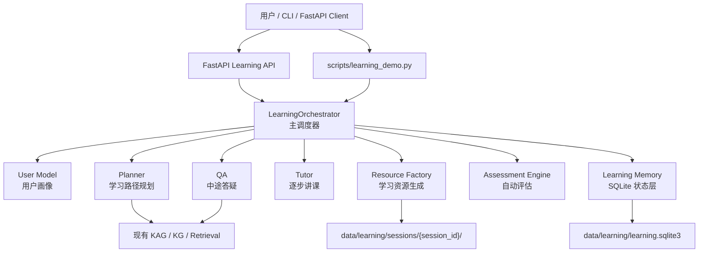
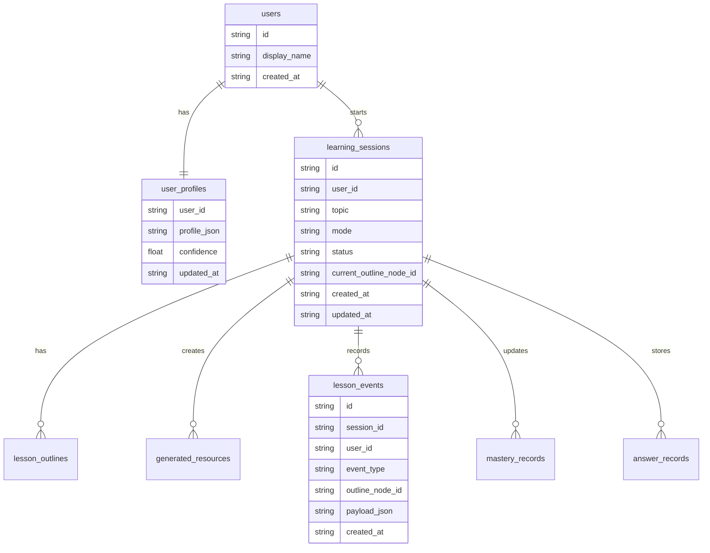
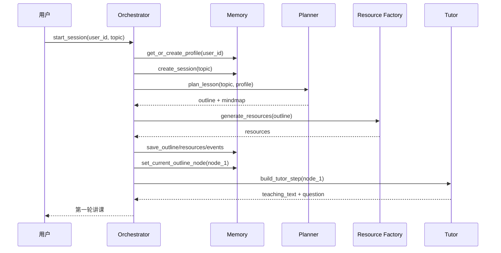
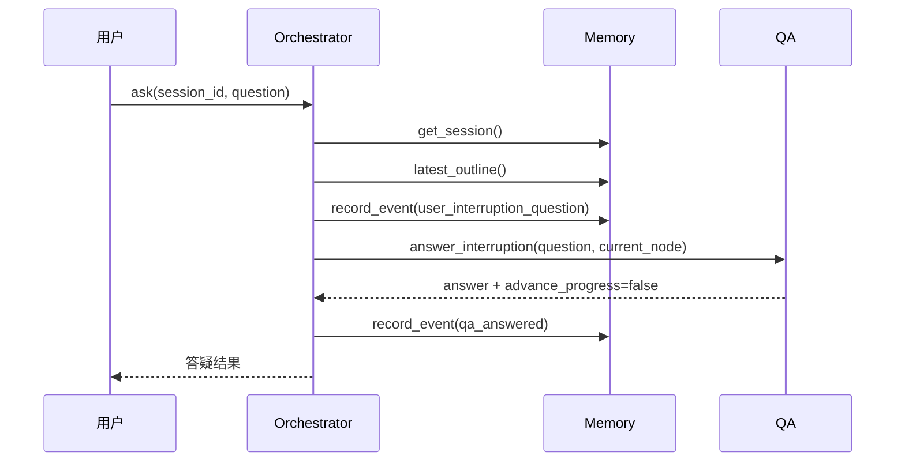
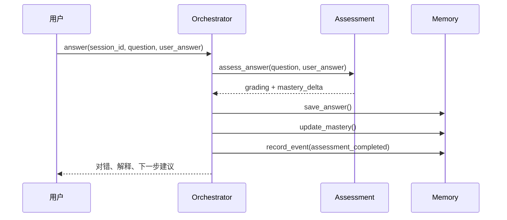

# OralSage 学习 Agent 架构说明

本文档面向合作开发队友，说明学习 Agent MVP 的后端架构、文件层次、每个文件的职责，以及一次完整学习流程中各模块如何协作。

## 1. MVP 目标

学习 Agent MVP 先做后端和终端闭环，不先做前端页面。

核心流程：

```text
用户输入想学的主题
-> 创建或读取用户画像
-> 基于现有 KAG 知识库生成学习路径
-> 基于同一个大纲生成讲义、slides、题目、阅读清单、思维导图
-> Tutor 按步骤讲课
-> 用户中途提问时进入 QA 答疑，但不推进课程进度
-> 用户答题后 Assessment 自动判题并更新掌握度
-> Tutor 根据掌握度决定继续、补讲或加练
-> 输出学习总结
```

MVP 不做：

- 新前端学习页。
- 视频生成。
- 独立 Evaluator Agent。
- 新检索算子。
- reranker 接入。
- 复杂权限系统。

## 2. 总体分层



一句话理解：

```text
Agent 负责教学决策和内容生成；
Service 负责状态、资源和评估；
Orchestrator 负责把它们串成一条稳定流程。
```

## 3. 新增目录结构

计划新增学习域模块：

```text
backend/services/learning/
  __init__.py
  schemas.py
  memory.py
  user_model.py
  planner.py
  resource_factory.py
  tutor.py
  qa.py
  assessment.py
  orchestrator.py
  prompts/
    planner.md
    tutor.md
    qa.md
    user_model.md
    handout.md
    slides.md

scripts/
  learning_demo.py
  smoke_test_learning.py

tests/
  test_learning_memory.py
  test_learning_orchestrator.py
  test_learning_resource_factory.py

data/learning/
  learning.sqlite3
  sessions/
    {session_id}/
      handout.md
      slides.json
      base_questions.json
      reading_list.json
      mindmap.json
      course.pptx
```

## 4. 每个文件的职责

### 4.1 `backend/services/learning/__init__.py`

学习模块包入口。

职责：

- 暴露 learning service 的主要 public class。
- 让外部可以通过 `backend.services.learning` 导入核心对象。

预期内容很少，例如：

```python
from .orchestrator import LearningOrchestrator
```

### 4.2 `backend/services/learning/schemas.py`

学习域数据结构定义。

职责：

- 定义用户画像结构。
- 定义学习大纲结构。
- 定义通用 Agent 返回结构。
- 定义 Tutor step、Assessment result 等内部协议。

典型结构：

```text
LearningProfile
OutlineNode
LessonOutline
AgentResult
TutorStep
AssessmentResult
```

这个文件只放结构，不写业务流程。

### 4.3 `backend/services/learning/memory.py`

SQLite 学习记忆层。

职责：

- 初始化 SQLite 数据表。
- 创建和读取用户。
- 创建和读取用户画像。
- 创建学习 session。
- 保存 outline、资源、事件流。
- 保存答题记录。
- 更新掌握度。
- 输出 session summary。

它是“课程进度不被答疑打断”的关键。当前课程进度保存在：

```text
learning_sessions.current_outline_node_id
```

QA 答疑只能写事件和困惑点，不能修改这个字段。

### 4.4 `backend/services/learning/user_model.py`

用户画像 Agent。

职责：

- 根据快速诊断答案生成初始画像。
- 没有画像时返回低置信度默认画像。
- 根据学习事件增量更新画像。

初始画像字段包括：

```text
level                 基础水平
goal                  学习目标
preferred_explanation 偏好的讲解方式
pace                  学习节奏
known_weak_points     已知薄弱点
mistake_patterns      错题类型
target_exam           目标考试
confidence            画像置信度
```

MVP 阶段可先用规则标准化，不强依赖 LLM。

### 4.5 `backend/services/learning/planner.py`

路径规划 Agent。

职责：

- 接收用户想学的主题。
- 读取用户画像和掌握情况。
- 优先复用现有 KAG / KG / retrieval 能力。
- 生成课程 `outline`。
- 顺便生成 `mindmap` JSON。

Planner 不负责讲课，也不负责生成讲义。它只回答：

```text
这节课应该按什么顺序学？
每一步对应哪些知识点和学习目标？
```

输出示例：

```json
{
  "outline": {
    "title": "牙周炎系统学习路径",
    "nodes": [
      {
        "id": "node_1",
        "title": "牙周炎的定义与疾病本质",
        "kg_node_ids": [],
        "learning_objectives": ["理解牙周炎和牙龈炎的核心区别"],
        "prerequisites": [],
        "estimated_minutes": 8,
        "difficulty": "basic",
        "source_refs": []
      }
    ]
  },
  "mindmap": {
    "format": "markmap_json",
    "root": {}
  }
}
```

### 4.6 `backend/services/learning/resource_factory.py`

学习资源生成工厂。

职责：

- 接收 Planner 输出的同一个 outline。
- 生成讲义、slides、题目、阅读清单、思维导图。
- 可选生成 PPTX。
- 把资源写入 `data/learning/sessions/{session_id}/`。

它不是 Agent，而是确定性资源生成流程。

输入：

```text
session_id
topic
outline
mindmap
```

输出：

```text
handout.md
slides.json
base_questions.json
reading_list.json
mindmap.json
course.pptx
```

PPTX 生成建议：

```text
outline -> slides.json -> PptxGenJS -> course.pptx
```

如果 PPTX 失败，不能影响课程开始。系统保留 `slides.json`，并把 PPTX 标记为 partial。

### 4.7 `backend/services/learning/tutor.py`

讲师 Agent。

职责：

- 根据当前 outline node 生成本轮讲解。
- 给出当前小测题。
- 根据 Assessment 结果生成反馈。
- 决定下一步是继续、补讲还是加练。

Tutor 每次只讲一步，不一次性讲完整节课。

输入：

```text
outline
current_outline_node_id
mastery state
user profile
```

输出：

```json
{
  "outline_node_id": "node_1",
  "teaching_text": "现在讲牙周炎的定义...",
  "question": {},
  "expected_user_action": "answer",
  "progress": {
    "current_index": 1,
    "total": 5
  }
}
```

### 4.8 `backend/services/learning/qa.py`

中途答疑 Agent。

职责：

- 处理讲课过程中用户突然提问。
- 使用当前课程上下文和 KAG evidence 回答。
- 输出困惑标签。
- 告诉 Tutor 是否后续需要补强。
- 明确不推进课程进度。

关键约束：

```text
QA 不能修改 current_outline_node_id。
```

QA 输出里建议显式带：

```json
{
  "advance_progress": false,
  "should_tutor_reinforce_later": true
}
```

这样方便测试和答辩展示。

### 4.9 `backend/services/learning/assessment.py`

评估引擎。

职责：

- 自动判题。
- 计算掌握度变化。
- 标记错题类型。
- 给 Tutor 提供下一步建议。

它不是独立 Agent，也不直接和用户聊天。

触发时机：

```text
用户提交答案
用户中途提问
小节结束
课程总结
```

MVP 第一版先支持：

```text
single_choice
true_false
```

后续再扩展简答题和临床案例题的 LLM 结构化评分。

### 4.10 `backend/services/learning/orchestrator.py`

学习主调度器。

职责：

- 提供 `start_session`、`ask`、`answer`、`next`、`resources`、`summary` 等方法。
- 负责调用 User Model、Planner、Resource Factory、Tutor、QA、Assessment 和 Memory。
- 保证每个用户动作都能写入事件流。
- 保证 QA 打断不改变课程进度。

它是学习系统的核心入口。

主要方法：

```text
start_session(user_id, topic)
ask(session_id, question)
answer(session_id, question, user_answer)
next(session_id)
resources(session_id)
summary(session_id)
```

### 4.11 `backend/services/learning/prompts/*.md`

Prompt 文件。

职责：

- 保存 Planner、Tutor、QA、User Model、讲义、slides 的提示词。
- 避免把长 prompt 写死在 Python 代码里。
- 方便队友单独调 prompt。

MVP 可以先规则生成，prompt 文件先作为接口约定和后续 LLM 接入位置。

## 5. FastAPI 文件改动

### 5.1 `backend/schemas.py`

新增学习 API 请求模型：

```text
LearningProfileDiagnoseRequest
LearningSessionStartRequest
LearningAskRequest
LearningAnswerRequest
LearningNextRequest
```

职责：

- 定义 FastAPI 请求体。
- 避免 endpoint 直接接收散乱 dict。

### 5.2 `backend/main.py`

新增 FastAPI endpoint：

```text
POST /api/learning/profile/diagnose
POST /api/learning/session/start
POST /api/learning/session/{session_id}/next
POST /api/learning/session/{session_id}/ask
POST /api/learning/session/{session_id}/answer
GET  /api/learning/session/{session_id}/summary
GET  /api/learning/session/{session_id}/resources
```

这些 endpoint 只负责：

```text
解析请求
调用 LearningOrchestrator
返回 JSONResponse
```

业务逻辑不能写在 `main.py` 里。

## 6. 脚本文件

### 6.1 `scripts/learning_demo.py`

终端交互 demo。

命令：

```text
/start
/next
/ask 问题
/answer A
/resources
/summary
/quit
```

用途：

- 给开发者和答辩演示看完整链路。
- 不依赖前端。
- 能手动验证“打断不推进课程进度”。

### 6.2 `scripts/smoke_test_learning.py`

一键 smoke test。

用途：

- 自动跑完整流程。
- 确认 start、ask、answer、next、resources、summary 都能跑。
- 适合每次改 learning 模块后快速检查。

建议输出：

```text
learning smoke test passed
```

## 7. 测试文件

### 7.1 `tests/test_learning_memory.py`

测试 SQLite 学习记忆层。

重点：

- 创建用户和默认画像。
- 创建 session。
- 写入事件。
- 保存 outline。
- QA 事件不改变 current node。

### 7.2 `tests/test_learning_orchestrator.py`

测试主流程。

重点：

- `start_session` 能生成 session 和 tutor step。
- `ask` 不推进课程进度。
- `answer` 能生成评估结果。
- `next` 能继续课程。

### 7.3 `tests/test_learning_resource_factory.py`

测试资源生成。

重点：

- 生成 `handout.md`。
- 生成 `slides.json`。
- 生成 `base_questions.json`。
- 生成 `reading_list.json`。
- 生成 `mindmap.json`。
- PPTX 失败时不阻塞主流程。

## 8. SQLite 表结构



最关键字段：

```text
learning_sessions.current_outline_node_id
```

它表示课程讲到哪里。中途答疑只能记录事件，不能修改它。

## 9. 一次完整调用链

### 9.1 开始课程



### 9.2 中途答疑



验收点：

```text
ask 前 current_outline_node_id == ask 后 current_outline_node_id
```

### 9.3 答题评估



## 10. 终端可见验收顺序

开发建议按下面顺序推进，每一步都能让队友在终端看到成果。

### Step 1: 学习记忆库

目标：

```text
能创建用户、画像、session、事件。
```

终端验收：

```bash
python scripts/smoke_test_learning_memory.py
```

预期看到：

```text
创建用户 demo
创建默认画像
创建课程 session
写入 lesson_started 事件
SQLite 路径: data/learning/learning.sqlite3
learning memory smoke test passed
```

### Step 2: Planner

目标：

```text
输入主题，输出学习路径和 mindmap JSON。
```

终端验收：

```bash
python scripts/smoke_test_learning_planner.py --topic 牙周炎
```

预期看到：

```text
课程标题：牙周炎系统学习路径
node_1: 牙周炎的定义与疾病本质
node_2: 牙周炎的病因和关键机制
...
```

### Step 3: Resource Factory

目标：

```text
基于同一 outline 生成学习资源文件。
```

终端验收：

```bash
python scripts/smoke_test_learning_resources.py --topic 牙周炎
```

预期看到：

```text
handout.md 已生成
slides.json 已生成
base_questions.json 已生成
reading_list.json 已生成
mindmap.json 已生成
```

### Step 4: Tutor 单步讲课

目标：

```text
能根据 current node 输出讲课文本和小测题。
```

终端验收：

```bash
python scripts/smoke_test_learning_tutor.py --topic 牙周炎
```

预期看到：

```text
当前节点：node_1
讲解文本：...
小测题：...
```

### Step 5: QA 打断

目标：

```text
中途答疑不推进课程进度。
```

终端验收：

```bash
python scripts/smoke_test_learning_interrupt.py
```

预期看到：

```text
打断前 current_node: node_1
用户提问：为什么牙周炎会导致牙槽骨吸收？
QA 回答：...
打断后 current_node: node_1
结果：课程进度未推进
```

### Step 6: Assessment

目标：

```text
答题后判题，并更新掌握度。
```

终端验收：

```bash
python scripts/smoke_test_learning_assessment.py
```

预期看到：

```text
题目 q_1
用户答案 A
正确答案 B
判定：错误
mastery: 0.50 -> 0.45
recommendation: reinforce
```

### Step 7: 全链路 CLI

目标：

```text
完整跑通 start、ask、answer、next、resources、summary。
```

终端验收：

```bash
python scripts/learning_demo.py --user demo --topic 牙周炎
```

手动输入：

```text
/start
/ask 为什么牙周炎会导致牙槽骨吸收？
/answer A
/next
/resources
/summary
/quit
```

### Step 8: FastAPI

目标：

```text
用 API 调用同一套 Orchestrator。
```

启动：

```bash
uvicorn backend.main:app --reload
```

调用：

```bash
curl -X POST http://127.0.0.1:8000/api/learning/session/start ^
  -H "Content-Type: application/json" ^
  -d "{\"user_id\":\"demo\",\"topic\":\"牙周炎\"}"
```

## 11. 开发分工建议

可以这样分给队友：

```text
队友 A：memory.py + SQLite 表 + memory smoke test
队友 B：planner.py + KAG 接入 + planner smoke test
队友 C：resource_factory.py + slides/handout/questions/mindmap
队友 D：tutor.py + qa.py + assessment.py
队友 E：orchestrator.py + CLI + FastAPI endpoints
```

接口边界：

- Planner 只输出 outline/mindmap，不写数据库。
- Resource Factory 只根据 outline 写资源，不决定课程顺序。
- Tutor 只生成当前 step，不直接改数据库。
- QA 只答疑并输出标签，不推进进度。
- Assessment 只判题和给更新建议，不直接面向用户聊天。
- Orchestrator 是唯一串流程、写事件、推进进度的地方。

## 12. 最容易踩坑的点

### 12.1 把进度推进写进 QA

不要这样做。QA 答疑必须不推进课程。

正确做法：

```text
QA 输出 advance_progress=false
Orchestrator 保持 current_outline_node_id 不变
```

### 12.2 讲义、PPT、题目各自生成大纲

不要这样做。会导致资源互相矛盾。

正确做法：

```text
Planner 生成唯一 outline
Resource Factory 复用同一个 outline 派生资源
```

### 12.3 把业务逻辑写进 FastAPI endpoint

不要这样做。

正确做法：

```text
main.py endpoint -> LearningOrchestrator -> learning service modules
```

### 12.4 让 Tutor 自己“记住”状态

不要这样做。Tutor 是生成器，不是数据库。

正确做法：

```text
Learning Memory 保存状态
Tutor 每次读取当前状态生成输出
```

### 12.5 PPTX 卡住主流程

不要让 PPTX 导出阻塞课程开始。

正确做法：

```text
slides.json 必须生成
course.pptx 尽力生成
失败时记录 partial，并继续
```

## 13. 当前项目如何接入

当前 OralSage 后端已经使用 FastAPI：

```text
backend/main.py
backend/schemas.py
backend/services/
```

学习 Agent 应该沿用这个结构：

```text
FastAPI endpoint 只做接口层
backend/services/learning/ 做学习业务层
data/learning/ 保存学习状态和资源
scripts/ 做终端演示
tests/ 做自动化测试
```

这样后续接前端时，只需要调用 `/api/learning/...` 这些接口，不需要重写学习逻辑。

