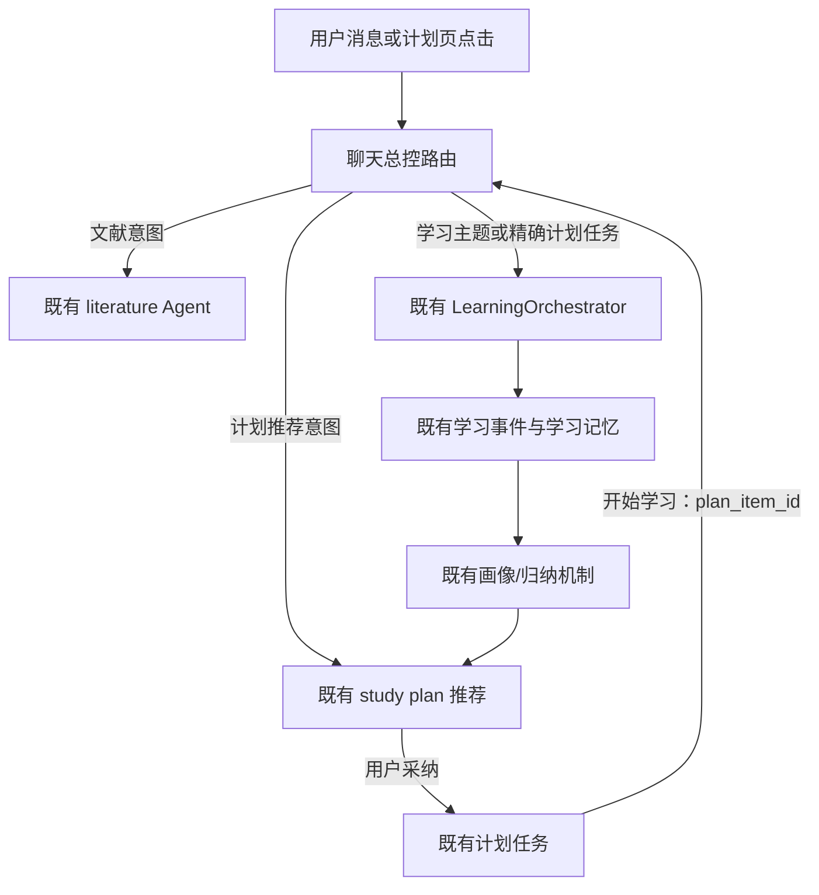

# 学习总控调度接入计划

## 当前交付状态

- 工作区：`C:\Users\luzhiyi\OralSage`
- 项目目标：恢复学习型聊天总控，使其只调度既有的学习主链路、学习计划推荐和文献检索/翻译能力；支持从既有学习计划精确启动学习。
- 已验证的端到端边界：真实浏览器已验证学习与计划推荐从 master-chat 到既有下游结果的链路；也已验证无效 `plan_item_id` 的真实拒绝和 URL 清理。计划页入口仅完成静态实现，尚未证明真实开放任务的入口到 session 全链路。
- 最近一次健康检查：2026-07-12 最终只读健康检查通过；独立复跑 master-chat 50 passed、master-router 47 passed、open-plan query 6 passed。
- 已知风险/待决事项：文献真实运行时、有效/多候选计划项启动、非本人/完成项拒绝和画像/记忆事件链均为 `cannot prove`：当前 SQLite 无计划项，且没有真实浏览器文献产物；不得为此创建数据、修外部下游或扩张前端。
- 下一步：开发完成，停止等待用户指令；不得 commit、push 或继续扩张范围。

## 已确认的产品范围

本次总控只调度三类既有能力：

1. **学习主链路**：用户说“我要学……”“我想了解……”，或要开始执行既有学习计划时，创建或进入现有学习 session，由既有学习编排器负责路径、讲解、答疑、测验和进度。
2. **计划推荐**：用户说“我今天学什么”“帮我安排学习计划”时，调用现有计划推荐能力并展示推荐。推荐不自动写入计划，仍需用户采纳。
3. **文献能力**：用户提出论文检索、最新研究、文献综述、文章翻译等需求时，调用既有 literature Agent。

当前不新增独立的复习链路、刷题链路或画像 Agent。若用户现在说“复习某主题”或“做题”，总控不承诺新的专用路径；是否和如何复用学习主链路，需在本项目之外单独确认。

## 当前实现事实（须在阶段 0 复核）

- `backend/main.py` 的 `/api/router/chat` 现委托 `MasterRouter`；`frontend/js/master-chat.js` 现实际调用该入口、统一渲染响应并保存真实 session ID。
- 学习主链路已有 `LearningOrchestrator`，并有学习 session 启动、路由、执行、教学、答疑、评估和继续学习接口。
- 计划推荐已有 `backend/services/learning/study_plan.py`，以 learner memory、用户画像、活跃 session、掌握度、延期任务等为输入，返回预览推荐。
- 计划任务已有真实存储表 `study_plan_items`，包含 `id`、`user_id`、`title`、`status`、`linked_course_id`、`linked_course_title`、`kg_node_ids` 等字段。
- 文献能力已有 `backend/services/literature/agent.py`，提供 PubMed/可选 Elsevier 检索、关键词处理、综述和单篇翻译，并已暴露独立 API。
- 画像/学习记忆已有 `backend/services/learning/profile_memory.py`、learning memory 和 `/api/learning/memory/consolidate` 等实现；已发现学习编排器和计划完成路径存在记忆更新调用，但尚未逐事件确认真实写入字段、触发时机及归纳机制。

上述条目是当前盘点结果，不构成对完整运行链路的验收结论。

## 架构边界

### 内容真源

| 范围 | 当前真源 |
|---|---|
| 学习 session、学习事件、掌握度 | 既有 `LearningOrchestrator` 与 learning memory |
| 用户画像、画像切片、记忆归纳 | 既有 `profile_memory.py` 与 profile/learner-memory 存储 |
| 学习计划任务 | `study_plan_items` 与 study plan 服务 |
| 计划推荐结果 | 既有 `recommend_study_plan(...)` 的计算结果 |
| 文献检索、综述、翻译 | 既有 literature Agent |
| 聊天会话本地展示状态 | 既有 master-chat 前端状态与 localStorage |

### 新责任归属

总控路由层只负责：

- 识别请求属于学习、计划推荐、文献或需要澄清；
- 提取并验证 `user_id`、`session_id`、`plan_item_id` 等上下文；
- 调用现有下游能力；
- 返回统一、可供聊天页渲染的响应。

总控不得重新实现教学、答疑、判题、推荐算法、文献检索、翻译或画像写入。

### LLM 与确定性代码边界

- 对自然语言的意图判断、模糊计划提及与主题理解，应由受限输出的总控 LLM 判断。
- Python/服务端仅负责校验路由枚举、校验用户归属和任务状态、检索候选、阻止歧义自动执行、调用既有服务和保持状态。
- 计划页点击产生的 `plan_item_id` 是显式事实，不需要 LLM 猜测。
- 不允许用关键词硬编码替代总控 LLM 的语义判断，也不允许让 LLM 直接写计划、改画像或推进课程。

### 本项目不应改动的层

- 学习主链路中 Tutor、QA、Assessment 和课程推进的内部逻辑；
- 画像归纳与 learner memory 的既有写入规则；
- 计划推荐算法和计划数据结构；
- 文献 Agent 的检索、翻译和摘要实现。

## 目标数据流



## 总控契约

### 输入

```text
message
user_id（默认 demo）
history（可选）
context.session_id（可选；已有学习上下文）
context.plan_item_id（可选；计划页精确跳转）
```

### 输出

```text
route.intent: learning | study_plan | literature | clarification
route.target: learning_orchestrator | study_plan | frontier_literature | none
route.reason: 面向用户的简短分流理由
route.source: explicit_plan_item | llm_router
final_result: 下游既有结果或候选项
next_action: start_session | show_recommendations | show_literature | select_plan
```

### 路由规则

| 条件 | 总控行为 | 是否写状态 |
|---|---|---|
| `context.plan_item_id` 存在 | 精确读取该用户的计划任务，验证状态后启动学习 | 仅创建既有学习 session；不完成计划 |
| 文献检索/论文/指南更新/翻译 | 调用既有 literature Agent | 否 |
| 今日任务/安排计划/推荐学习 | 调用既有计划推荐 | 否 |
| 学习主题/了解知识点/开始学习 | 调用既有学习 session 启动 | 创建既有学习 session |
| 提及计划且唯一候选 | 用该候选精确启动学习 | 创建既有学习 session；不完成计划 |
| 提及计划且多个候选 | 返回候选，等待用户选择 | 否 |
| 意图不清或未找到计划 | 澄清或退回普通主题学习选择 | 否 |

### “开始学习”与“完成任务”的语义

- 计划页的按钮命名为“开始学习”，其行为是启动对应的学习 session。
- 计划页原有勾选/完成操作才表示“完成任务”。
- 聊天中的“我要完成 xx 计划”在本项目语境中解释为“开始执行该计划”；总控回复中应清晰说明已经开始学习，不能提前将计划状态改成 completed。
- 后续是否在课程真正完成后提示或自动完成计划，属于新产品决策，不纳入本项目。

## 分阶段计划

### 阶段 0 审核记录：通过（2026-07-11）

本阶段只读审核已完成，未修改任何实现、未提交、未推送。审查使用分支/提交/工作区状态、代码调用点和 Claude 完整证据表进行交叉核验。

| 范围 | 已冻结事实 | 关键证据 |
|---|---|---|
| 学习事件与记忆 | `lesson_started`、教学、答题、答疑和进度事件均通过 `_update_learner_memory_for_event(...)` 走实时 L1→L3 best-effort 更新；后台 outline 完成事件不写 learner memory。 | `backend/services/learning/orchestrator.py:147`, `254`, `267`, `1744`, `1962`, `2283` |
| 计划与记忆 | 创建、延期仅记录计划 event；完成才通过 `_apply_completion_memory(...)` 写入 rhythm/persistence 信号。 | `backend/services/learning/study_plan.py:150`, `180`, `193`, `342` |
| 归纳与画像 | `consolidate_l2/l3` 仅由显式 consolidate API 触发；实时信号写入后由 reducer 刷新 profile state，两个读取 API 也 best-effort 刷新。 | `backend/main.py:1113`, `778`, `1060`; `backend/services/learning/profile_memory.py:529`, `547` |
| 学习启动 | `start_lesson(user_id, topic, display_name, profile_input)` 返回真实 session、outline、首步资源和 `learner_memory_update`；失败抛出明确异常。 | `backend/services/learning/orchestrator.py:177`, `217`, `310` |
| 计划任务 | `title` 必填；关联课程和 KG 节点可为空。任务主题解析优先级尚不存在于实现，必须由后续总控适配层按文档最小实现。 | `backend/services/learning/memory.py:129`, `530`; `backend/services/learning/study_plan.py:121` |
| 文献 | 既有检索/翻译 API 保留结构化结果和 `errors` 降级，供总控直接调用与透传。 | `backend/services/literature/agent.py:177`, `266`; `backend/main.py:354`, `370` |
| 聊天入口 | 阶段 0 时 master-chat/router 都是 placeholder；当前实现与运行时状态见阶段 1a–2b 记录，不能再将该冻结发现当作当前事实。 | 阶段 0：`frontend/js/master-chat.js:3`, `415`, `430`; `backend/main.py:176`, `2108` |

本阶段未证明任何动态端到端链路；这不是失败，而是阶段 1 之后必须进行的运行时验收边界。

### 阶段 1a 审核记录：通过（2026-07-11）

后端 router placeholder 已接入独立 `MasterRouter`，并保持下游服务边界不变。HTTP 输入契约复核确认：`RouterChatRequest` 为 `history` 提供空列表默认值、为 `context` 提供包含 `user_id=demo` 的默认值；显式 `user_id`、`session_id` 与 `plan_item_id` 会传至 router。

- 修改范围：`backend/main.py`、`backend/schemas.py`、`backend/services/router/`、`tests/test_master_router.py`。
- 审核：无 commit/push；未修改 frontend、learning、literature 或画像实现；`PYTHONDONTWRITEBYTECODE=1 python -m pytest tests/test_master_router.py -q` 通过（36 passed）。
- 已知风险：当前证据为 mock 下游/API 层契约；真实用户可见链路仍待后续运行时验收。下游不可用时不得修复下游，只返回其真实失败。

### 阶段 1b 审核记录：通过（静态实现，2026-07-11）

`master-chat.js` 已由本地 placeholder 改为 `POST /api/router/chat`；它发送 `message/history/context`，按统一 `route/final_result/next_action` 渲染，保存后端真实 `session.id`，并如实展示 HTTP、后端失败及 clarification。

- 修改范围：`frontend/js/master-chat.js`、`tests/test_master_chat.js`。
- 审核：`tests/test_master_chat.js` 24 passed；未修改 CSS、HTML、后端或下游链路，无 commit/push。
- 未完成证据：尚未在浏览器中证明页面实际加载本次 router 响应；该运行时验收必须以唯一正/反标记完成，不能由静态测试替代。

### 阶段 1c 运行时验收：通过（学习与计划推荐，2026-07-11）

真实浏览器通过 master-chat 输入“我要学习口腔溃疡”和“推荐我今天学什么”，确认两次 `POST /api/router/chat`、真实 LLM route、LearningOrchestrator session/recommendation 结果均进入最终 DOM；旧 placeholder 三个反向标记均未出现。

- 正向标记：真实 `lesson_f856a5ac1594` session ID、route meta、`recommendation_id`。
- 反向标记：`学习总控待接入`、`旧总控 agent 已停用`、`learning_router_placeholder` 均未出现在 DOM。
- 未验证：文献下游（外部依赖）和显式 `plan_item_id` 路径。它们不得被推断为通过。

### 阶段 2a 审核记录：通过（URL 精确计划上下文，2026-07-11）

聊天页已在初始化时读取 `plan_item_id`，自动以空 message 和 `{user_id, plan_item_id}` 调用既有 router，并在完成后清理 URL 参数以保证一次性提交。前端不读取或伪造计划任务内容。

- 修改范围：`frontend/js/master-chat.js`、`tests/test_master_chat.js`。
- 审核：`node --test tests/test_master_chat.js` 通过（41 passed）；未修改 backend、计划页、CSS/HTML，无 commit/push。
- 未完成证据：尚未在真实浏览器验证 `plan_item_id` 成功、非本人/已完成拒绝和 URL 清理；下一轮只做运行时证据采集。

### 阶段 2b 运行时验收：通过（无效计划任务拒绝，2026-07-11）

真实浏览器打开 `master-chat.html?plan_item_id=nonexistent-verify-ad3f7b92&user_id=demo`，捕获到真实 router 请求和 `ok:false` 响应；后端拒绝原因进入最终 DOM，随后 URL 清理完成。

- 正向标记：`Study plan item not found or access denied: nonexistent-verify-ad3f7b92` 出现在聊天 DOM。
- 反向标记：四个旧 placeholder 标记均未出现。
- 未验证：真实开放任务成功启动、非本人/已完成任务拒绝；当前 demo 数据不可安全提供这些状态，需在不写数据的前提下后续验证。

### 阶段 4 静态实现：通过（计划页“开始学习”入口，2026-07-11）

开放状态计划项现在渲染复用既有 `todo-tool` 样式的“开始学习”链接，且 URL 只携带经 `encodeURIComponent` 处理的 `plan_item_id`；`completed` 项不渲染入口。该入口不改计划状态、后端、聊天页、HTML 或 CSS。

- 修改范围：`frontend/js/learning-plan.js`、`tests/test_learning_plan.js`。
- 审核：持久化任务具备 `completed`、退出码 `0` 和非空 `report.md`；独立复跑 `node --test tests/test_learning_plan.js tests/test_master_chat.js` 通过（2 files, 42 assertions/records reported by the suites）；无 commit/push，diff 不含禁止文件。
- 未完成证据：尚未从真实开放计划项点击入口并证明 `plan_item_id` → router → 已有 `start_lesson` → 可见 session 结果；不得用手写计划数据或下游 shaped fixture 冒充该验收。

### 项目健康检查：通过（只读，2026-07-12）

持久化健康检查具备 `completed`、退出码 `0` 和非空报告；主控独立复跑 router（36 passed）与两个前端测试套件（均通过），检查了工作区、最近提交、完整 diff、运行时截图及旧 placeholder 反向标记。学习、计划推荐和无效 `plan_item_id` 拒绝已有真实浏览器证据；文献、真实开放任务启动、非本人/完成任务拒绝、画像事件链仍是 `cannot prove`，未改下游或制造数据。

- 运行时证据：`C:\Users\luzhiyi\OralSage\.codex-claude-tasks\runs\oralsage-runtime-validation-20260711-2050\03_test1_after_response.png` 已独立打开；包含真实学习响应和 `start_session` 路由标记，旧 placeholder 标记未出现。
- 风险记录：`backend/main.py` 中旧 `_learning_router_stub` 与 capabilities 中的 placeholder 标记是 P2 清理候选，非当前阻塞，未修改。

### 模糊计划候选架构澄清：通过（只读，2026-07-12）

计划已要求“基于当前用户未完成计划取得候选；唯一候选启动，多个候选返回选择项”；实际 `_handle_learning` 仍将整段自由文本直接交给 `start_lesson`，该路径缺失。现有 `LearningMemory.list_study_plan_items(user_id, start_date, end_date)` 按用户/日期范围读取真实项目，但没有按 `status='open'` 的查询；显式 ID 的归属和状态校验已在 `_handle_plan_item` 中存在。

- 架构结论：不新增数据结构、API 或并行 UI 即可补齐；候选必须由既有计划真源按用户和 open 状态过滤，LLM 只能在候选 ID 集内受限选择，聊天页只消费统一 `select_plan` 响应并回传明确 ID。
- 计划治理：原先将该节点在健康检查中列为用户范围选择不正确；证据表明它是已确认计划要求，修正为现有架构内的缺失实现。受影响节点是阶段 2 的模糊文本分支和阶段 6 的候选场景；阶段 1–4 已完成节点不变。下一步先做只读 B1 契约冻结，若发现需新增 API、数据结构、并行 UI 或多层 handoff 则停止。

### 阶段 0：只读架构核查与契约冻结

**目的**：以真实实现为证据核实画像、计划和学习主链路的衔接，消除目前关于画像更新时机的不确定性。

**必须核实**：

1. 学习启动、教学、答题、答疑、章节推进、课程完成分别记录什么 event，是否和如何触发 learner memory 更新。
2. 计划创建、采纳、完成、延期分别是否更新学习记忆或画像信号。
3. `consolidate` 与 `refresh_profile_state_from_l3` 的调用者、输入输出、自动/显式触发条件。
4. `start_lesson` 的真实输入、session 输出、首个学习步骤状态与失败语义。
5. 计划任务的课程字段、标题和 KG 字段在真实任务中的来源、优先级和空值行为。
6. 文献检索、翻译及其失败降级响应的真实契约。
7. 聊天页 URL 参数、localStorage 和渲染生命周期，确认新 session 不会被旧缓存覆盖。

**产物**：一张“真实上游输入 → 中间 contract/cache → 下游消费者 → 可见输出”的证据表；并逐项标注“通过、失败、无法验证”。

**停止条件**：若发现总控接入需要修改画像数据结构、替换学习 session 协议，或同时改变计划表、多个 API、缓存和前端消费者，停止并先发布架构澄清任务。

### 阶段 1：后端总控路由

**目的**：将 `/api/router/chat` 从 placeholder 改为统一调度入口。

**最小架构增量**：新增一个总控路由服务/适配层；它调用既有学习、计划和文献服务，不改下游责任边界。

**实现要求**：

1. LLM 路由输出受限于总控契约中的四个 intent；服务端严格校验。
2. 文献和计划推荐直接调用现有服务，并保留原始下游结果在 `final_result`。
3. 普通学习请求调用现有 session 启动，而不是生成新的教学/路径逻辑。
4. 已有 `session_id` 时只作为上下文传递；不得在总控中复制学习主链路的继续、答疑、判题流程。
5. 无法判断时返回 clarification，不允许随意创建学习 session 或写计划。

**数据衔接验收**：真实聊天请求 → 经验证的 route object → 真实下游 API/服务结果 → 统一总控响应。禁止用手写的 downstream-shaped 总控响应冒充调用成功。

### 阶段 2：精确计划任务启动学习

**目的**：让计划页和聊天文本都能以现有计划任务为真源，可靠启动该任务的学习内容。

**真实链路**：

```text
真实 study_plan_items 任务
→ 按 user_id + plan_item_id 读取
→ 依据已确认字段解析学习主题
→ 调用既有 start_lesson
→ 返回真实 session / outline / 首步状态
→ 聊天页保存并使用 session_id
```

**主题解析原则**：

1. 优先使用已关联课程的真实标题/信息。
2. 其次使用计划任务标题。
3. 只有在现有学习主链路本来支持时，才把 `kg_node_ids` 作为辅助上下文；不伪造课程实体。
4. 任务不存在、非当前用户、已完成、没有可用主题时，返回明确提示，不创建错误 session。

**模糊文本原则**：

- 总控先基于该用户的未完成计划获取候选，再由 LLM 结合用户文本作受限选择。
- 唯一候选可继续；多个候选必须返回选择项和明确 `plan_item_id`。
- 禁止以标题 substring 命中后直接启动任意任务。

**非目标**：不在此阶段把启动学习写为计划完成，也不在路由器中新增画像写入。

### 阶段 3：聊天页接入

**目的**：让 `/pages/master-chat.html` 实际调用总控，并根据统一响应展示三类结果。

**展示要求**：

- 文献结果复用已有文献卡片、摘要、翻译展示能力。
- 计划推荐展示任务、理由和采纳入口；采纳仍走既有计划 API。
- 学习结果展示主题、关联计划名（如有）、真实 session 状态和首个学习步骤。
- 候选计划展示选择按钮，点击后以 `plan_item_id` 重新调用总控。
- 聊天页保存当前 `session_id`；后续继续、提问和答题应转入既有学习 API。

**用户可见验收**：必须在浏览器运行时证明最终页面消费了目标总控响应；不能只证明请求成功或 DOM 初始状态正确。

### 阶段 4：计划页“开始学习”跳转

**目的**：给每个开放状态计划项提供明确的“开始学习”入口。

**行为**：

```text
点击开放任务的“开始学习”
→ 跳转 master-chat 页面，携带 plan_item_id
→ 聊天页自动调用总控
→ 总控精确启动该任务对应学习 session
```

**边界**：

- URL 不携带可被篡改的完整任务内容，只携带 ID；后端重新按当前用户读取真源。
- 不修改任务完成状态。
- 已完成任务不显示或禁用“开始学习”，具体交互以现有页面状态风格为准。

### 阶段 5：画像/记忆联动验收

**目的**：证明总控接入不绕过、重复或破坏既有画像更新。

**验收链路**：

```text
计划任务启动学习
→ 既有学习 session
→ 真实教学/答题/推进事件
→ 既有 learner memory 更新
→ 既有画像读取或归纳路径
```

**要求**：

- 不要求“开始 session”本身必须更新画像；以阶段 0 核实出的真实触发时机为准。
- 测试应证明后续真实事件仍走既有写入路径，或明确标记无法自动证明的链路。
- 若发现画像更新只在显式 consolidate 时发生，应在总控之外决定由谁触发；不得偷偷在路由器添加重复写入。

### 阶段 6：回归、端到端与健康检查

**必须覆盖的不同真实输入形态**：

| 场景 | 预期 |
|---|---|
| “我要学口腔溃疡” | 启动真实学习 session |
| “我想了解颞下颌关节紊乱” | 启动不同主题 session，证明非样例硬编码 |
| “推荐我今天学什么” | 返回推荐；不创建 session、不写计划 |
| “检索近两年口腔白斑文献” | 调用文献能力；不改变学习 session |
| 计划页提供的真实 `plan_item_id` | 精确启动该任务主题 |
| 文本仅匹配一个未完成计划 | 启动该任务 |
| 文本匹配多个未完成计划 | 返回澄清候选，不启动任意一个 |
| 已完成或非本人任务 | 拒绝精确启动并说明状态 |
| 启动学习后产生一个真实学习事件 | 按阶段 0 的实际规则证明或说明画像/记忆变化 |

**样例补丁防护**：

- 禁止对特定主题、标题、任务 ID、数组下标、页面 URL 或截图特征写特判。
- 每一条核心路由至少有一个与首个样例不同的主题/任务形态。
- 测试从真实 plan item、真实 session 输入或生产形态 API payload 开始，不能用已拼装好的总控最终响应冒充端到端验证。

**用户可见产物验收**：

1. 报告最终页面实际加载/消费的计划任务 ID、总控响应及 session ID。
2. 使用来自目标任务的唯一正向标记，验证其出现在运行时可见结果中。
3. 使用默认演示任务、旧聊天缓存或另一个同名候选的唯一反向标记，验证其未出现在最终输出中。
4. 不以 URL、HTTP 200、文件存在、schema 合法或主题名本身作为唯一验收证据。

## 推荐的后续任务拆分与审查顺序

每个任务均必须禁止 commit、push 和创建 PR；完成后先由主控审查 status、diff、测试完整输出和用户可见结果，再进入下一项。

1. **只读架构核查**：产出画像/计划/学习/聊天的真实契约证据表，不修改代码。
2. **后端总控路由与精确计划启动**：仅接入已确认的服务边界。
3. **前端聊天页与计划页联动**：只消费阶段 2 的真实接口契约。
4. **端到端回归与项目健康检查**：用真实生产形态输入验证全部关键手off。

若任一任务触发以下情况，必须停止并报告，不得私自扩张实现：

- 新建或替换一条完整端到端链路；
- 新增超过一个未经确认的跨层 handoff；
- 同时改变数据结构及两个以上的缓存、API、编排或渲染消费者；
- 为绕过缺失目标路径而建立并行实现或兜底链路。

## 完成定义

只有同时满足以下条件，本项目才可判定完成：

1. 聊天总控不再是 placeholder，且能可靠分发三类已确认能力。
2. 计划页可精确启动对应真实计划任务的学习 session。
3. 模糊计划提及不会误开多个候选中的任意一个。
4. 学习、计划、文献的职责未被总控重写或复制。
5. 画像更新链路已基于真实代码和真实事件得到“通过/失败/无法验证”的证据，而非猜测。
6. 后端、前端和用户可见运行时均完成真实链路验证，且无样例硬编码。

## 最终调度验收标准（新增）

本项目的最终验收只确认“总控能正确调度既有能力”，不把修复或重建下游能力扩大为本项目目标。必须从可打开的项目页面开始，在真实聊天入口输入用户需求，并在运行时逐项证明：

1. 用户可在正确的聊天窗口输入自然语言需求或由计划页传入明确的 `plan_item_id`。
2. 总控正确识别并分派已确认的学习、计划推荐、文献或澄清意图；不得用主题、任务 ID、页面索引或样例文本硬编码特判。
3. 分派调用的是既有对应链路，且总控响应能保留/回传该链路的真实结果、失败或澄清状态。
4. 对于当前已可运行且前端已有承载方式的链路，最终页面必须实际展示该次目标响应的结果；验收要给出目标结果的唯一正向标记，以及默认演示内容、旧缓存或其他候选结果未出现的反向标记。
5. 如果某个既有下游链路本身不能运行、不能生成结果，或现有前端没有可安全复用的展示承载，则不得为了通过总控验收去修复、重建或新增该下游链路。必须记录失败/无法验证的具体文件、契约、命令或运行时证据，并保持总控只返回该既有链路的真实失败/不可用状态。
6. 前端原则上不改动。唯一允许的最小前端改动是将现有 master-chat 的 placeholder 替换为实际对话请求、对统一总控响应的基础展示，以及必要的 `session_id`/`plan_item_id` 状态传递；不得重做页面、增加新的结果系统，或为无法展示的下游能力补建并行 UI。
7. 若最终发现完成“正确调度”仍需同时修复下游链路、改数据结构或扩展多个跨层消费者，停止并将其列为本项目外风险；该场景不得被视为本项目未完成的理由，也不得自行扩大改动范围。

### 文档修订记录

- 2026-07-11：新增“最终调度验收标准”。原因：明确本项目只交付正确识别、分派和既有结果回传；下游链路不可用或前端无安全承载时只记录证据，避免为验收而扩张为下游修复或大规模前端改造。
- 2026-07-11：记录阶段 0 静态契约核查结果并更新当前状态/下一步。原因：已通过代码调用点确认学习、计划、画像、文献和聊天入口的真实责任边界；同时明确动态端到端仍未验收，避免后续将静态证据误作运行时成功。
- 2026-07-11：记录阶段 1a 后端 router 与 HTTP 默认上下文验收。原因：普通聊天请求缺少 `context/history` 时会在 HTTP 入口失败；以最小 schema 默认值和 API 层测试修复，不改下游或前端。
- 2026-07-11：记录阶段 1b 聊天页 router 接入的静态验收。原因：已用最小前端改动替换 placeholder，但浏览器实际消费目标响应仍需独立验收，避免把文件/单测成功误作用户可见成功。
- 2026-07-11：记录阶段 1c 学习/计划推荐浏览器运行时验收。原因：已以唯一正/反标记证明真实 router 响应进入页面；文献与精确计划启动仍保留为未验证项。
- 2026-07-11：记录阶段 2a URL 精确计划上下文静态验收。原因：显式 ID 已在前端透传且无任务内容泄漏；实际后端拒绝/成功语义及 URL 清理仍需浏览器验证。
- 2026-07-11：记录阶段 2b 不存在计划任务浏览器验收。原因：以真实后端拒绝响应证明 URL 自动提交和错误展示，不创建测试计划数据。
- 2026-07-11：记录阶段 4 计划页入口静态验收。原因：以最小导航链接把开放计划项 ID 交给已存在的聊天页 URL 契约；真实开放任务运行时链路仍须单独证明。
- 2026-07-12：更正顶部“当前交付状态”。原先仍称 router/master-chat 为 placeholder、无动态验收，与阶段 1a–2b 的已核验实现和浏览器证据冲突；仅更新当前状态字段和下一步，未改变已完成节点、目标架构或范围，受影响的是后续健康检查的前提判断。
- 2026-07-12：记录健康检查与模糊计划候选架构澄清，并更正“当前实现事实”中仍把 placeholder 当作现状的陈述。原因：独立复跑测试、代码搜索与已打开的运行时证据确认当前 router/chat 已替换 placeholder；同时确认模糊候选是计划内缺失分支而非可选范围。修订不批准新架构，下一节点仍先冻结最小契约。
- 2026-07-12：冻结并复核模糊计划候选的数据访问契约。原因：既有日期范围查询不具备候选语义，任意窗口会漏掉真实 open 项；后续先以一个独立的 LearningMemory 查询方法按 `user_id + status='open'` 读取并稳定排序，不改表结构或 API。
- 2026-07-12：验收 `list_open_study_plan_items`。原因：方法以 SQL 的 `user_id + status='open'` 过滤所有日期的开放项并稳定排序；6 项新测试及既有生成/Router 测试均独立复跑通过。误建的 `docs/project-notes.md` 已由单独范围恢复任务删除并核验；下一步仅让 router 消费该查询，不改前端。
- 2026-07-12：验收模糊计划候选 router 返工。原因：候选匹配已归入 learning intent，计划推荐恢复既有 study_plan 职责；多个候选仅返回 `plan_item_id`、标题和课程标题，零/无效匹配保持自由学习，47 项 router 与 6 项查询测试独立通过。`docs/project-notes.md` 已再次核验不存在；下一步只让聊天页消费既有 `select_plan` 响应。
- 2026-07-12：验收 master-chat 候选消费。原因：聊天页仅渲染 router 的安全候选字段，点击复用已有 `autoSubmitPlanItem`，不在前端匹配或自动启动；50 项 Node 测试与 47 项 router 测试独立通过，`docs/project-notes.md` 不存在。下一步需以真实浏览器和现有数据验证候选展示/点击，数据不足则仅记录无法证明。
- 2026-07-12：候选展示运行时验证为 `cannot prove`。原因：主控独立只读查询 `data/learning/learning.sqlite3`，`study_plan_items` 无任何行，任务没有生成浏览器产物；依约不创建测试计划数据。静态候选合同仍由 50 项 Node 与 47 项 router 测试覆盖，不得把该结果表述为真实候选 UI 已通过。
- 2026-07-12：文献分流运行时验证为 `cannot prove`。原因：主控独立复跑 50 项聊天与 47 项 router 测试，确认静态分流/渲染契约与旧 placeholder 反向断言；但无真实浏览器/HTTP 文献产物，外部下游不作修复。下一步进行最终只读健康检查，汇总通过、失败与无法证明边界。
- 2026-07-12：最终健康检查通过并关闭开发。原因：学习、计划推荐、无效计划 ID 已有真实浏览器正/反标记；模糊候选与文献的实现/静态契约由独立回归覆盖。SQLite 实际无计划项且文献无真实浏览器产物，故相关链路保留为 `cannot prove`，符合最终调度验收的“只记录、不修下游/不造数据”边界。无 commit、push 或 PR。
